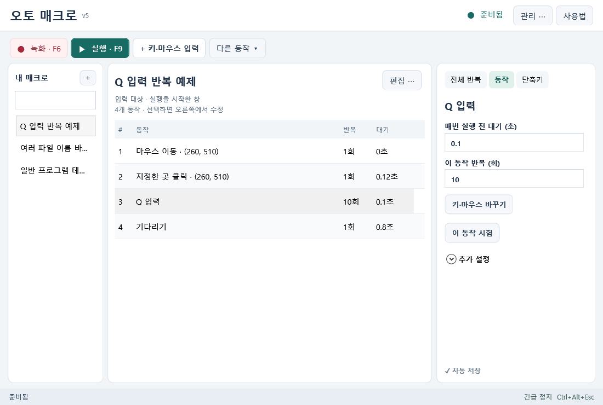
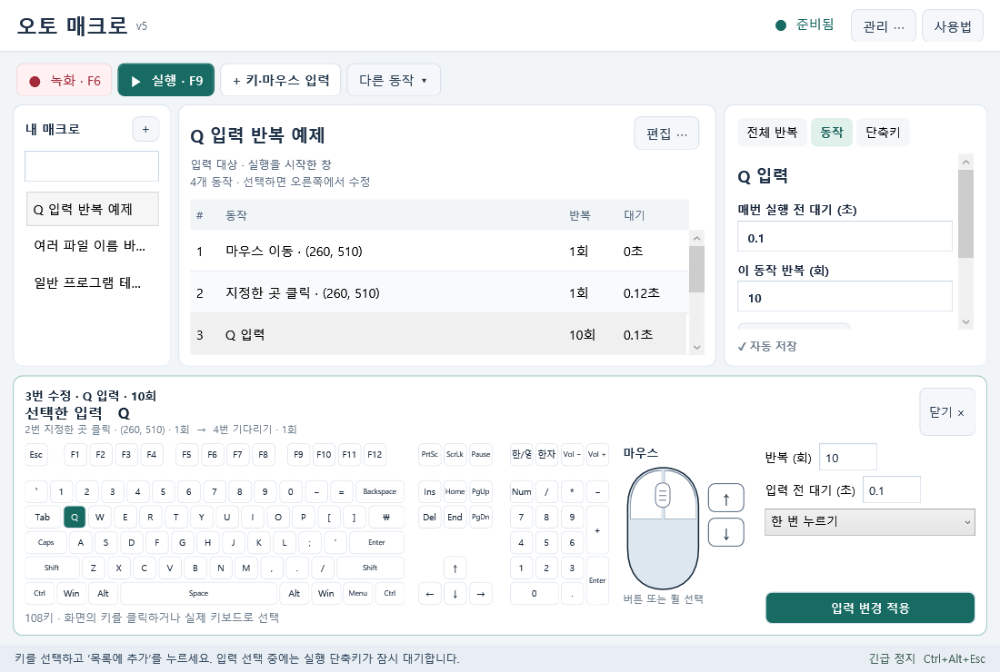
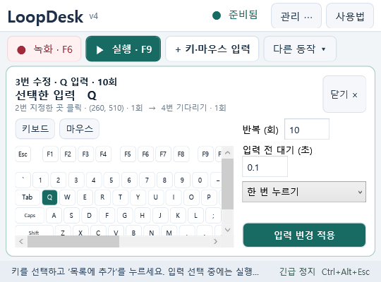
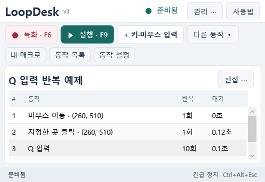

# 오토 매크로 v5

Windows 10·11 64비트용 마우스·키보드 매크로입니다.

**[오토 매크로 v5 다운로드 · 설치 없이 실행](https://github.com/glasscola/LoopDesk/releases/tag/v5)**

`오토 매크로-v5.exe` 하나를 원하는 폴더에 저장하고 실행하세요. [v1.1 보관용 설명서](docs/%EC%98%A4%ED%86%A0%20%EB%A7%A4%ED%81%AC%EB%A1%9C-%EC%82%AC%EC%9A%A9%EC%84%A4%EB%AA%85%EC%84%9C-v1.1.pdf)

## 쉽게 시작하기

1. 이전 버전이 대기 중이면 알림 영역에서 **완전히 종료**한 뒤 내려받은 `오토 매크로-v5.exe`를 실행합니다.
2. **녹화:** 대상 창에서 F6으로 시작하고 F7로 끝냅니다. 기존 동작이 있으면 돌아온 편집 창에서 새 매크로로 저장하거나 기존 매크로를 교체할 수 있습니다.
3. **직접 입력:** `+ 키·마우스 입력`을 누르면 하단에 108키 키보드가 펼쳐집니다. 키·마우스를 선택하고 반복 횟수와 입력 전 대기를 정한 뒤 `목록에 추가`를 누릅니다.
4. **수정:** 목록에서 동작을 선택해 오른쪽에서 수정합니다. 기본 동작과 전체 반복 설정은 자동 저장됩니다. 잘못된 입력은 이동 전에 수정해야 합니다. 고급 동작에는 변경 저장 버튼도 있습니다.
5. **실행:** 대상 창에서 F9. F10 일시정지·재개, F11 정지. Ctrl+Alt+Esc 긴급 정지. 단축키는 변경할 수 있습니다.

## v5 업데이트

- 프로그램 이름을 **오토 매크로**로 바꿨습니다. 기존 매크로, 단축키 및 백업을 그대로 열 수 있습니다.
- 새 매크로와 백업 파일은 각각 `.automacro`, `.automacro-backup`으로 저장됩니다.

## v4 업데이트

- 작은 창에서 108키 입력판을 열어도 추가 위치, 편집 중인 동작과 앞뒤 순서를 확인할 수 있습니다. 관리 → **연습 · Q 10회**에서 실제 입력칸이 받은 횟수를 확인합니다.
- **클릭 위치 확인**에서 직접 지정한 클릭·더블클릭·스크롤 위치를 확인할 수 있습니다. 연속 마우스 이동은 접어 보기로 정리하고, 두 번 클릭하면 원래 순서와 대기가 나타납니다.
- **묶음 펼쳐서 편집**을 누르면 묶음의 반복 횟수를 유지한 채 내부 동작을 수정할 수 있습니다. 실행이 실패하면 동작과 반복 회차가 표시됩니다.
- 이미지·글자 동작에서 **검색 범위 지정**을 누르고 F10으로 모서리 두 곳을 정합니다. **클릭 없이 조건 확인**은 검색 결과를 표시합니다. 이미지 클릭에서 여러 후보가 발견되면 멈춥니다.
- 처음 실행한 창을 대상으로 유지합니다. 다른 창이 필요한 구간에는 **다음 창 기다리기**를 추가하고, 활성 창을 계속 따라가려면 전체 반복 → 고급 설정에서 선택할 수 있습니다.
- 랜덤 딜레이 화면은 선택 동작의 대기와 실행 속도로 빠른 범위와 느린 범위를 나누어 보여줍니다. 연속 휠 입력에는 최소 0.1초 간격을 둡니다.
- CSV 부분 시험은 첫 행을 사용합니다. 문장 편집에서 CSV 열을 삽입하고 입력 예정 문장을 볼 수 있습니다.
- 전체 백업에 참조 그림을 포함합니다. CSV는 사용자가 포함을 선택할 수 있습니다.
- 예약에 평일 옵션과 대상 창을 기다릴 시간을 추가했습니다. 고급 설정에 다음 예약과 지난 결과가 표시됩니다.

## v3 업데이트

- 창을 540×400 논리 픽셀까지 줄일 수 있습니다. Windows 화면 배율에 따라 실제 픽셀 크기는 달라집니다.
- 좁은 창에서는 내 매크로, 동작 목록, 동작 설정을 버튼으로 전환합니다. 동작 줄을 두 번 클릭해 바로 설정을 열 수도 있습니다.
- 작은 창의 입력 화면에서 키보드와 마우스를 전환합니다. 키보드 영역은 스크롤할 수 있고 추가 버튼은 하단에 고정됩니다.

## v2 업데이트

- 하단 입력판에 실제 마우스 형태의 컨트롤을 추가했습니다. 좌우 버튼과 가운데 휠을 눌러 클릭을 추가하고, 화살표로 스크롤 방향을 선택합니다.
- [v2 검증 결과](docs/v2-verification.md)

## 1.1 업데이트

- 녹화·직접 입력·실행 중심으로 메인 화면 정리, 추가 편집 기능을 메뉴로 이동
- 108키 키보드를 하단으로 통합, 목록과 선택한 입력을 함께 표시
- 동작·반복 횟수·대기 시간을 목록에 구분해서 표시, 시간 입력은 초로 통일
- 기본 편집 자동 저장, 잘못된 입력 및 선택 이동 시 수정 내용 유실 방지
- 연속한 여러 동작 선택 후 편집 메뉴에서 묶음 반복, 오른쪽에서 횟수 변경. 묶음 풀기는 본문 한 벌을 복원하고 묶음 반복을 해제합니다. 조건 이동이 있는 매크로는 묶기 전에 조건을 해제해야 합니다.
- 드래그 순서 변경, 다중 동작 복제, Ctrl+Z 되돌리기·Ctrl+Y 다시 실행
- 녹화·실행 상태 표시, 실행 전 카운트다운, 실패한 동작으로 복귀
- 관리 메뉴의 전체 백업·복원, 저장 시 이전 파일 자동 백업
- 한국어 사용자별 설치 프로그램, 시작 메뉴 바로가기와 제거 지원

창을 닫아도 알림 영역에서 대기합니다. 키보드 선택 중에는 전역 단축키가 잠시 중단되며 키보드를 닫으면 재개됩니다. 예약은 오토 매크로가 대기 중이고 대상 앱이 앞에 열려 있을 때 실행합니다. 개별 매크로 내보내기는 참조 파일을 경로로 저장합니다. 연결 매크로와 그림을 다른 PC로 옮길 때는 관리 메뉴에서 전체 백업을 사용하세요.

## 빌드와 검증

Windows PowerShell에서 `./src/Build.ps1`로 빌드합니다. 생성된 `오토 매크로.exe`를 바로 실행할 수 있습니다.

실행 파일의 `--check 결과경로`, `--ui-check 결과경로`, `--tray-check 결과경로`로 각각 엔진·저장, 편집 흐름, 전역 단축키·녹화 창 복원 검사를 실행할 수 있습니다. 검사 모드는 개인 매크로를 저장하지 않습니다.
