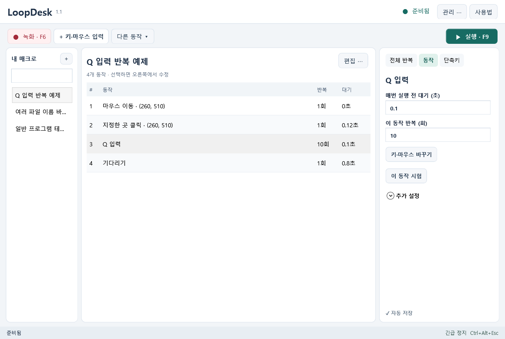
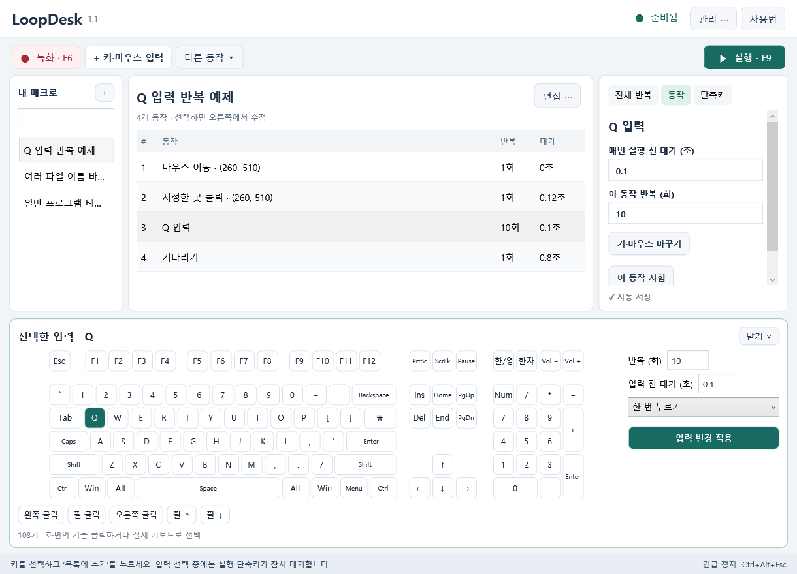

# LoopDesk 1.1.0

Windows 10·11 64비트용 마우스·키보드 매크로입니다.

[설치 프로그램 다운로드](https://github.com/glasscola/LoopDesk/releases/download/v1.1.0/LoopDesk-Setup-1.1.0.exe) · [포터블 실행 파일](https://github.com/glasscola/LoopDesk/releases/download/v1.1.0/LoopDesk.exe) · [PDF 설명서](docs/LoopDesk-사용설명서.pdf)

## 쉽게 시작하기

1. 기존 LoopDesk가 대기 중이면 알림 영역에서 **완전히 종료**한 뒤 설치합니다.
2. **녹화:** 대상 창에서 F6으로 녹화, F7로 저장합니다. 저장 후 편집 창이 돌아옵니다.
3. **직접 입력:** `+ 키·마우스 입력`을 누르면 하단에 108키 키보드가 펼쳐집니다. 키·마우스를 선택하고 반복 횟수와 입력 전 대기를 정한 뒤 `목록에 추가`를 누릅니다.
4. **수정:** 목록에서 동작을 선택해 오른쪽에서 수정합니다. 기본 동작과 전체 반복 설정은 자동 저장됩니다. 잘못된 입력은 이동 전에 수정해야 합니다. 고급 동작에는 변경 저장 버튼도 있습니다.
5. **실행:** 대상 창에서 F9. F10 일시정지·재개, F11 정지. Ctrl+Alt+Esc 긴급 정지. 단축키는 변경할 수 있습니다.

## 1.1 업데이트

- 녹화·직접 입력·실행 중심으로 메인 화면 정리, 추가 편집 기능을 메뉴로 이동
- 108키 키보드를 하단으로 통합, 목록과 선택한 입력을 함께 표시
- 동작·반복 횟수·대기 시간을 목록에 구분해서 표시, 시간 입력은 초로 통일
- 기본 편집 자동 저장, 잘못된 입력 및 선택 이동 시 수정 내용 유실 방지
- 연속한 여러 동작 선택 후 편집 메뉴에서 묶음 반복, 오른쪽에서 횟수 변경. 묶음 풀기는 본문 한 벌을 복원하고 묶음 반복을 해제합니다. 조건 이동이 있는 매크로는 묶기 전에 조건을 해제해야 합니다.
- 드래그 순서 변경, 다중 동작 복제, Ctrl+Z 되돌리기·Ctrl+Y 다시 실행
- 녹화·실행 상태 표시, 실행 전 카운트다운, 실패한 동작으로 복귀
- 관리 메뉴의 전체 백업·복원, 저장 시 이전 파일 자동 백업
- 한국어 사용자별 설치 프로그램, 시작 메뉴 바로가기와 제거 지원

창을 닫아도 알림 영역에서 대기합니다. 키보드 선택 중에는 전역 단축키가 잠시 중단되며 키보드를 닫으면 재개됩니다. 예약은 LoopDesk가 대기 중이고 대상 앱이 앞에 열려 있을 때 실행합니다. 이미지·CSV는 경로를 참조하므로 다른 PC로 옮길 때 함께 보관해야 합니다.

## 빌드와 검증

Windows PowerShell에서 `./src/Build.ps1`로 빌드합니다. 별도의 외부 실행 라이브러리는 필요하지 않습니다. 설치 프로그램은 Inno Setup 6.7 이상에서 `installer/LoopDesk.iss`를 빌드합니다.

실행 파일의 `--check 결과경로`, `--ui-check 결과경로`, `--tray-check 결과경로`로 각각 엔진·저장, 편집 흐름, 전역 단축키·녹화 창 복원 검사를 실행할 수 있습니다. 검사 모드는 개인 매크로를 저장하지 않습니다.
